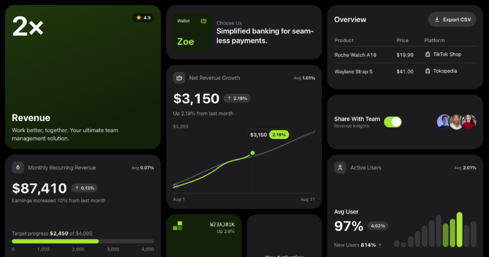

<div align="center">

# Infinite Bento (`UIzBENTO`)

**144 interactive, responsive Bento UI cards with live theme customization, `⌘K` command palette, one-click card/CSS export, and GSAP choreography.**

[](https://uizbento.vercel.app/)
[](https://tailwindcss.com/)
[](https://gsap.com/)
[](./LICENSE)
[](https://github.com/ericsn-ui/uiz-bento/stargazers)

**[Explore the Live Showcase →](https://uizbento.vercel.app/)**



</div>

---

## Why `UIzBENTO`?

Most UI showcases are static screenshots. `UIzBENTO` is a **zero-runtime, copy-ready** interactive bento library built in pure HTML, pre-compiled Tailwind CSS, and vanilla JavaScript:

| Capability | What It Does |
| :--- | :--- |
| **144 Interactive Cards** | Every card is responsive, keyboard-accessible, and interactive out of the box. |
| **One-Click Copy Card HTML** | Hover or focus any card and click **Copy** to grab its clean HTML + Tailwind markup. |
| **Appearance Studio (`Theme & Fonts`)** | Switch between 6 color presets (`Olive`, `Cobalt`, `Indigo`, `Ember`, `Rose`, `Mono`), `Light / Dark / Auto`, 5 font pairings, and `Comfortable / Compact` density — persisted in `localStorage`. |
| **Export Theme CSS** | Copy the active `:root` CSS variables directly from the Appearance Studio dock into your own stylesheet. |
| **Command Palette (`Cmd/Ctrl + K`)** | Instant keyboard search, category filtering, jump-to-card highlighting, and quick studio actions. |
| **GSAP + ScrollTrigger Motion** | Batched stagger entrances, scrubbed media parallax, pointer-tracked radial hover glow + 3D tilt, and `prefers-reduced-motion` support. |
| **Infinite Vertical Loop** | Seamless endless scrolling with a toggle to pause into single-pass bounded scrolling. |

---

## Card Categories

Organized across four modular sections (`Dashboard`, `Widgets`, `SEO Analytics`, and `Showcase`):

| Category | Examples Included |
| :--- | :--- |
| **Dashboard & Finance** | Revenue highlights, MRR growth, net revenue charts, crypto/BTC market & swap widgets, savings, investment mix |
| **Productivity & Widgets** | Calendars, focus/work timer, AI file organizer simulator, notification inbox, quick links, weather & media players |
| **SEO & Growth Analytics** | Traffic overview, keyword rankings, conversion funnels, audience retention, shareable report cards |
| **Showcase & Commerce** | Pricing toggles, live CSS token exporter, community invites, interactive forms, login & onboarding states |

---

## Local Development

Preview locally over any static HTTP server (zero build step required):

```bash
python3 -m http.server 8090
```

Rebuild production CSS after modifying `src/tailwind.css` or `index.html`:

```bash
npm install
npm run build:css
```

Or run Tailwind CLI without installing `node_modules`:

```bash
npx -y tailwindcss@3.4.16 -c tailwind.config.js -i src/tailwind.css -o styles.css --minify
```

---

## Deploying to Vercel

- **Framework Preset**: `Other`
- **Root Directory**: `./`
- **Build Command**: Leave empty to serve pre-compiled `styles.css`, or set `npm run build`
- **Output Directory**: `.`
- **Live URL**: [uizbento.vercel.app](https://uizbento.vercel.app/)

---

## License

Released under the [MIT License](./LICENSE). If `UIzBENTO` sparks an idea or saves you time, consider giving it a ⭐!
